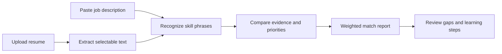

# Clearpath — Resume-to-Job Gap Analyzer


**Turn a job description into a clear, evidence-based plan for your next application.**

Clearpath compares a resume with a target role, shows which recognized skills appear in both, highlights priority gaps, and suggests practical ways to build and demonstrate those skills.

> Clearpath is a career-planning aid. Its score is not an ATS result, hiring prediction, or measure of a person's potential.

## The problem

Applicants often receive little feedback after applying. A job listing may name many requirements, while a resume presents the candidate's experience in different language. It can be hard to see what already aligns, what is not visible in the resume, and what to learn next.

## The solution

Upload a resume and paste a job description. Clearpath extracts selectable resume text, maps common skill phrases to a curated vocabulary, and returns a transparent match report with evidence and suggested next steps.

## ✨ Key features

- **Resume upload** — accepts text-based PDF, DOCX, and TXT files up to 10 MB.
- **Weighted role match** — gives required skills twice the weight of preferred skills and explains the calculation.
- **Evidence for matches and gaps** — shows the relevant phrases found in the job description and resume.
- **Priority skill gaps** — separates required and preferred skills to help guide a learning plan.
- **Practical growth suggestions** — pairs recognized gaps with a project exercise and a learning resource.
- **Optional semantic suggestions** — local sentence-transformer matching can suggest related phrases for review; those matches receive half credit.
- **Sample analysis and report export** — try the fictional demo profile and download the report as Markdown.
- **Responsive blue-glass interface** — a calm, accessible workflow for desktop and mobile.
- **Privacy-minded processing** — resume files are handled in memory for the request; Clearpath does not save files or analysis history.

## 🧰 Tech stack

| Layer | Technology | Purpose |
| --- | --- | --- |
| Frontend | React 19, Vite 6, CSS | Responsive upload flow and interactive results |
| API | Python, FastAPI | Resume parsing, skill matching, and report data |
| PDF parsing | pypdf | Extract selectable text from PDFs |
| DOCX parsing | python-docx | Read Word resume content |
| Matching | Curated skill vocabulary and aliases | Transparent, deterministic phrase matching |
| Optional NLP | sentence-transformers | Local related-phrase suggestions when enabled |
| Quality checks | Python unittest, Node test runner, GitHub Actions | Analyzer checks, build, and Sites adapter checks |

## 🔄 How it works



1. **Provide the inputs.** Upload a PDF, DOCX, or TXT resume and paste the role description.
2. **Extract and recognize.** The API extracts resume text and maps skill names and aliases from both inputs to Clearpath's curated vocabulary.
3. **Compare evidence.** Clearpath identifies direct matches, missing recognized skills, and whether each job requirement is required or preferred.
4. **Review the score.** Required skills count twice as much as preferred skills. Direct matches receive full credit. Optional semantic suggestions receive half credit and are labeled for review.
5. **Choose a next step.** Review evidence excerpts, practice tasks, and links to learning resources. Export the report if useful.

## 📊 Understanding the score

The percentage is weighted coverage of the **recognized skills in the job description**:

`earned skill weight ÷ total recognized skill weight × 100`

Required skills have a weight of 2; preferred skills have a weight of 1. Skills without an explicit preferred label default to required. A missing phrase means Clearpath did not find evidence in the extracted resume text; it does not prove the candidate lacks the skill. Matching is limited by the curated vocabulary and the wording of the inputs.

## 🚀 Run locally

Requires Python 3.10+ and Node.js 20+.

### 1. Set up and start the API

```powershell
python -m venv .venv
.venv\Scripts\Activate.ps1
python -m pip install -r requirements.txt
python -m uvicorn api.main:app --reload --port 8001
```

### 2. Start the web app

In a second terminal, from the project folder:

```powershell
npm install
npm run dev
```

Open the local URL printed by Vite and choose **Try a sample** to explore the complete flow with fictional data.

### Optional semantic matching

The standard setup uses deterministic curated phrase matching. To enable related-phrase suggestions with a local sentence-transformer model:

```powershell
python -m pip install -r requirements-semantic.txt
$env:CLEARPATH_SEMANTIC_MATCHING = "true"
python -m uvicorn api.main:app --reload --port 8001
```

The `sentence-transformers/all-MiniLM-L6-v2` model downloads on first use. Semantic comparison runs locally, and suggested related matches should be reviewed against the quoted resume evidence. See `.env.example` for available settings.

## ✅ Verification

```powershell
python -m unittest discover -s tests -p "test_*.py"
npm run build
npm run test:sites
```

The repository also includes a GitHub Actions workflow that runs the Python checks, production build, and Sites adapter suite on pushes and pull requests.

## 🔒 Privacy and current limitations

- No account system, database, or analysis history is included.
- The API reads uploaded files for the current request and does not persist them. The browser keeps the selected file and report in page memory until cleared or closed.
- Only selectable text is extracted; scanned PDFs requiring OCR are not supported.
- Skill coverage is based on an editable vocabulary, so transferable experience expressed in different words may not be recognized.
- The project is a local portfolio MVP. A public production deployment should add a privacy notice, HTTPS, request and rate limits, monitoring, and a retention review.

## 📁 Project structure

```text
api/main.py              FastAPI upload, extraction, and matching API
src/App.jsx              React upload flow and evidence-backed report
src/styles.css           Responsive blue-glass design system
public/sample-resume.txt Fictional demo resume
samples/                 Synthetic fixtures
tests/                   Analyzer and Sites adapter checks
worker/                  Static Sites request adapter
```

## License

No license file is included yet. Add a license if you want others to have explicit permission to reuse or modify the code.
