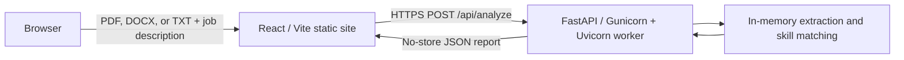

# Clearpath — Resume-to-Job Gap Analyzer


Clearpath compares a resume with a target job description, explains recognized skill matches with evidence, prioritizes gaps, and suggests practical learning steps.

> Clearpath is a career-planning aid. Its score is not an ATS result, hiring prediction, or measure of a person's potential.

## What it solves

Job seekers rarely receive detailed rejection feedback. Clearpath helps turn a job listing into an understandable plan by showing which recognized skills are already visible in a resume, which requirements are missing from the extracted text, and what to practise next.

## Features

- Upload a text-based PDF, DOCX, or UTF-8 TXT resume up to 10 MB.
- Compare recognized skills using a transparent, curated vocabulary and aliases.
- Weight required skills twice as much as preferred skills.
- Show job-description and resume evidence for each direct match.
- Offer priority gaps, project exercises, and learning resources.
- Download a Markdown report and use a fictional one-click sample.
- Optionally use local sentence-transformer related-phrase suggestions.
- Apply file validation, size limits, safe error messages, no-store responses, and per-instance rate limiting.
- Deploy as a Render static React site plus a Render FastAPI web service.

## Architecture



| Layer | Technology | Purpose |
| --- | --- | --- |
| Frontend | React 19, Vite 6, CSS | Responsive upload and results interface |
| Backend | Python 3.12, FastAPI | Upload validation, extraction, and analysis API |
| Production server | Gunicorn with Uvicorn workers | Runs the ASGI application on Render |
| Resume parsing | pypdf, python-docx | Extract selectable PDF and DOCX text |
| Matching | Curated vocabulary and aliases | Explainable direct phrase matching |
| Optional NLP | sentence-transformers | Local related-phrase suggestions |
| Deployment | Render Blueprint | Defines a static site and Python web service |
| Verification | unittest, Node test runner, GitHub Actions | API checks, build, and static-adapter checks |

## API endpoints

| Method | Path | Purpose |
| --- | --- | --- |
| `GET` | `/api/health` | Render health check and service availability |
| `POST` | `/api/analyze` | Multipart resume upload and job-description analysis |

`POST /api/analyze` accepts the `resume` file field and `job_description` text field. It returns a non-persistent JSON report with skill evidence, weighted coverage, gaps, and learning resources.

## Privacy and data handling

Clearpath receives the uploaded resume only to extract text and create the current analysis response. It does not write resume files, personal details, or reports to a database or analysis history. The browser retains the selected file and report in page memory until the user clears it or closes the page. Responses use `Cache-Control: no-store, private`.

The report redacts email addresses, phone numbers, and URLs from displayed evidence snippets. For public deployment, use HTTPS, publish this notice, and avoid uploading documents containing data that is unnecessary for the analysis.

## Local setup

Requirements: Python 3.12+ and Node.js 20+.

### 1. Create the backend environment

```powershell
cd "C:\Users\Prabhath kumar A\OneDrive\ドキュメント\ChatGPT\python project\resume-gap-analyzer"
python -m venv .venv
.venv\Scripts\Activate.ps1
python -m pip install -r requirements.txt
Copy-Item .env.example .env
python -m uvicorn api.main:app --reload --host 127.0.0.1 --port 8001
```

### 2. Start the frontend

Open a second PowerShell window in the same project directory:

```powershell
npm ci
npm run dev
```

Open the Vite address shown in the terminal, normally `http://localhost:5174`. With `VITE_API_BASE_URL` blank, Vite proxies `/api` requests to `http://127.0.0.1:8001` for local development.

### Preview the production frontend locally

```powershell
npm run build
npm run preview
```

For local API development, use the Uvicorn command above. The Gunicorn command in `render.yaml` is for Render's Linux runtime.

## Environment variables

Copy `.env.example` locally. Do not commit `.env` files.

| Service | Variable | Example / purpose |
| --- | --- | --- |
| Static site | `VITE_API_BASE_URL` | `https://your-api.onrender.com`; used at build time by Vite |
| API | `FRONTEND_ORIGINS` | Exact comma-separated origins, e.g. `https://your-web.onrender.com` |
| API | `CLEARPATH_MAX_UPLOAD_BYTES` | Maximum resume bytes; default `10485760` |
| API | `CLEARPATH_MAX_JOB_DESCRIPTION_CHARS` | Maximum job-description size; default `20000` |
| API | `CLEARPATH_RATE_LIMIT_REQUESTS` | Analyses allowed per IP and window per service instance; default `12` |
| API | `CLEARPATH_RATE_LIMIT_WINDOW_SECONDS` | Rate-limit window; default `60` |
| API | `CLEARPATH_SEMANTIC_MATCHING` | Keep `false` for the standard Render deployment |
| API | `CLEARPATH_SEMANTIC_MODEL` | Optional local model name when semantic mode is enabled |
| API | `CLEARPATH_SEMANTIC_THRESHOLD` | Optional related-phrase similarity threshold; default `0.58` |

No API keys, passwords, database URLs, or other secrets are required for the standard deployment.

## Deploy to Render

The repository includes [`render.yaml`](render.yaml), which defines both services. The React app must be a Render **Static Site** and the API must be a Render **Web Service**. The static site sends browser requests to the public API URL; a static site cannot run FastAPI itself.

1. Push this project, including `render.yaml`, to GitHub.
2. In Render, choose **New +** → **Blueprint** and connect the GitHub repository.
3. Render detects `render.yaml` and proposes two services: `clearpath-api` and `clearpath-web`.
4. During Blueprint setup, enter `FRONTEND_ORIGINS` for the API as the exact public static-site origin. Example: `https://your-clearpath-web.onrender.com`.
5. Enter `VITE_API_BASE_URL` for the static site as the exact public API origin. Example: `https://your-clearpath-api.onrender.com`. Do not add `/api` to this value.
6. Create the Blueprint and wait for both deployments to finish. Render runs `pip install -r requirements.txt` and starts the API with Gunicorn/Uvicorn. It runs `npm ci && npm run build` and publishes `dist/client` for the static site.
7. Open `https://your-clearpath-api.onrender.com/api/health`. It should return `{"status":"ok","service":"clearpath-analysis"}`.
8. Open the static-site URL, choose **Try a sample**, and select **See my match**. A successful result verifies browser-to-API CORS and multipart upload connectivity.
9. If you later add a custom frontend domain, append it to `FRONTEND_ORIGINS` on the API service, save, and redeploy the API. If you change the API URL, update `VITE_API_BASE_URL` on the static site and redeploy the static site because Vite embeds it during the build.

The Blueprint uses Render's `PORT` environment variable through its API start command and checks `/api/health` after deployment. The production configuration keeps optional semantic matching disabled because its model increases memory use and downloads on first use.

## Verify locally

```powershell
python -m unittest discover -s tests -p "test_*.py"
npm run build
npm run test:sites
```

The Python suite covers matching behavior, evidence redaction, upload validation, upload-size limits, health responses, and CORS. The frontend build validates that the Vite production bundle can be created, and the Node suite verifies the existing static Sites adapter.

## Current limitations

- Scanned PDFs requiring OCR are not supported.
- The rate limiter is in memory and therefore applies per API service instance. Use an external shared limiter before horizontal scaling.
- The score covers recognized skills and wording. It cannot establish whether a person has a skill that is absent from the extracted resume text.
